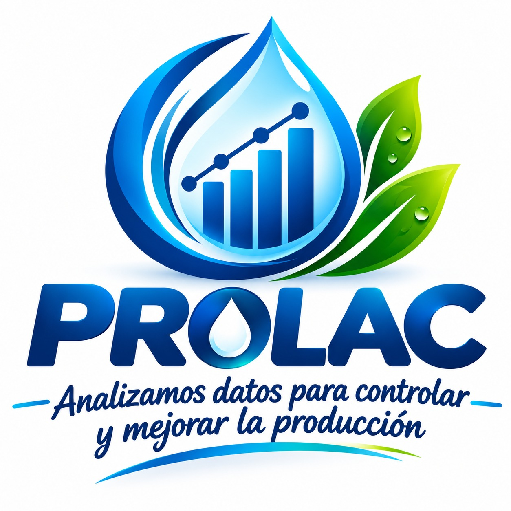
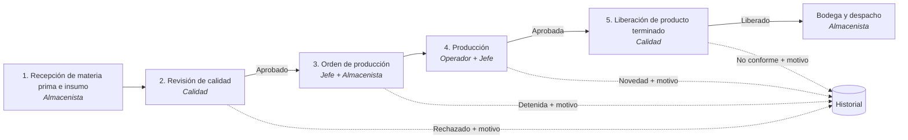

<p align="center">
  
</p>

<h1 align="center">Sistema de Control Estadístico y Trazabilidad en Procesos Lácteos</h1>

<p align="center">
  Aplicación web para controlar el inventario de una planta de productos lácteos: registra cada movimiento,
  guarda un historial que no se puede borrar, deja constancia de todo lo que no pasa a la siguiente etapa con su motivo
  y genera reportes y gráficas para la toma de decisiones.
</p>

<p align="center">
  <a href="https://TU-APP.onrender.com"><b>Ver el sistema en línea</b></a>
</p>

---

## Contenido

- [Qué hace](#qué-hace)
- [Roles](#roles)
- [Flujo del proceso](#flujo-del-proceso)
- [Tecnologías](#tecnologías)
- [Estructura del proyecto](#estructura-del-proyecto)
- [Instalación local](#instalación-local)
- [Variables de entorno](#variables-de-entorno)
- [Comandos útiles](#comandos-útiles)
- [Publicación en la web](#publicación-en-la-web)
- [Autores](#autores)

---

## Qué hace

- **Registro de cada movimiento** desde la llegada de la materia prima hasta el despacho al cliente.
- **Historial inmodificable:** la base de datos rechaza cualquier intento de editar o borrar un movimiento.
- **Lo que no pasa queda registrado:** rechazos, devoluciones, órdenes detenidas y novedades guardan su motivo.
- **Control de calidad por parámetros:** cada material y tipo de producto tiene sus rangos; el sistema dice si un valor está dentro o fuera.
- **Fórmulas de producción:** calcula cuánta materia prima, empaque y desinfectante necesita cada orden y si alcanza el inventario.
- **Trazabilidad completa:** de un lote de producto se ve de qué proveedores vino, quién lo produjo, quién lo liberó y a qué clientes llegó; y al revés, desde un lote de proveedor.
- **Gráficas y 7 reportes** descargables en Excel y PDF, comparados con el periodo anterior.
- **Recuperación de contraseña por correo** y diseño adaptable a celular.

## Roles

Cada persona tiene un solo rol y solo ve sus propias pantallas.

| Rol | Qué hace en el sistema |
| --- | --- |
| **Gerente** | Consulta el resumen, gráficas, trazabilidad, historial y reportes. Administra usuarios, proveedores, clientes, materiales y productos. |
| **Almacenista** | Registra la recepción de materia prima e insumos, entrega materiales a producción, guarda en bodega y despacha a clientes. |
| **Supervisor de Calidad** | Define los parámetros de calidad, revisa los materiales que llegan y libera los lotes de producto terminado. |
| **Jefe de Producción** | Define las fórmulas, crea las órdenes de producción y revisa lo que produce el operador. |
| **Operador** | Ve su orden asignada y registra la producción: limpieza, parámetros del proceso, cantidad y novedades. |

## Flujo del proceso



## Tecnologías

| Parte | Herramienta |
| --- | --- |
| Lenguaje y framework | Python · Django 6.1 |
| Base de datos | PostgreSQL en Supabase |
| Pantallas | HTML, CSS y JavaScript (plantillas de Django) |
| Reportes | openpyxl (Excel) · reportlab (PDF) |
| Publicación | Render · WhiteNoise · Gunicorn |
| Correo | Gmail (en local) · Brevo (en la web) |

## Estructura del proyecto

```
├── config/          Configuración general, rutas y envío de correo
├── usuarios/        Usuarios, roles, inicio de sesión y menú por rol
├── catalogo/        Materiales, productos y tamaños, proveedores y clientes
├── inventario/      Recepción, entregas, lotes, despachos e historial
├── calidad/         Parámetros, revisión de material y liberación de lotes
├── produccion/      Fórmulas, órdenes, registro y revisión de producción
├── reportes/        Resumen, gráficas, trazabilidad, historial y reportes
├── templates/       Pantallas (HTML)
└── static/          Estilos y logo
```

## Instalación local

Requisitos: Python 3.12 o superior, Git y una base de datos PostgreSQL (por ejemplo, un proyecto gratis en Supabase).

```bash
git clone https://github.com/SergioBJ/Sistema-Lacteos2.git
cd sistema-lacteos2
python -m venv venv
venv\Scripts\activate          # En Mac o Linux: source venv/bin/activate
pip install -r requirements.txt
```

Crea un archivo `.env` junto a `manage.py` (ver [Variables de entorno](#variables-de-entorno)) y luego:

```bash
python manage.py migrate
python manage.py createsuperuser     # Rol: GERENTE
python manage.py runserver
```

Abre http://127.0.0.1:8000 e inicia sesión.

## Variables de entorno

El archivo `.env` **nunca se sube a GitHub**. Contiene:

| Variable | Para qué |
| --- | --- |
| `SECRET_KEY` | Clave secreta de Django |
| `DEBUG` | `True` en el computador, `False` en la web |
| `DATABASE_URL` | Cadena de conexión a PostgreSQL (Session pooler de Supabase) |
| `CORREO_USUARIO` | Correo remitente del sistema |
| `CORREO_CLAVE` | Contraseña de aplicación de Gmail (solo en local) |
| `BREVO_API_KEY` | Clave de Brevo para enviar correos desde la web |

Si no se configura ningún correo, los mensajes se muestran en la terminal.

## Comandos útiles

| Comando | Qué hace |
| --- | --- |
| `python manage.py runserver` | Arranca el programa en el computador |
| `python manage.py migrate` | Crea o actualiza las tablas |
| `python manage.py limpiar_datos` | Borra los datos de prueba sin tocar los usuarios |
| `python manage.py limpiar_datos --todo` | Borra también materiales, productos, proveedores y clientes |

## Publicación en la web

El sistema está publicado en Render. Cada `git push` a la rama `main` lo vuelve a publicar.

- **Build Command:** `pip install -r requirements.txt && python manage.py collectstatic --noinput && python manage.py migrate`
- **Start Command:** `gunicorn config.wsgi:application`

## Autores

Proyecto académico desarrollado por:

- **Tu Nombre** · [Sergio Bello Julio](https://github.com/SergioBJ)

---

<p align="center"><i>Proyecto universitario · 2026</i></p>
